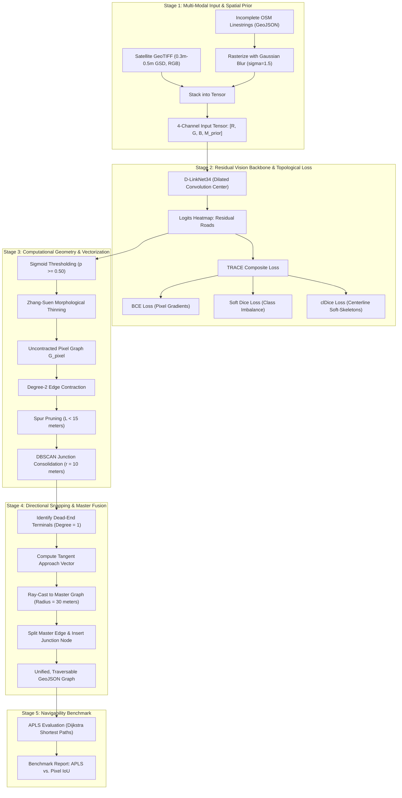

# TRACE: System Architecture, Mathematical Foundations & Implementation Analysis

**Document ID:** `TRACE-DOC-002`  
**Version:** `1.0.0`  
**System Name:** **TRACE** (*Topological Road Augmentation and Completion Engine*)

---

## 1. End-to-End Pipeline Workflow



---

## 2. Mathematical Foundations

### 2.1 Coordinate Synchronization & Affine Transformations
Satellite imagery is acquired in projected coordinates (typically UTM meters, e.g., `EPSG:32611`), whereas OpenStreetMap vectors are natively distributed in angular geographic coordinates (`WGS 84`, `EPSG:4326`).

1. **Reprojection:** Coordinates $(\phi, \lambda)$ are reprojected to UTM plane coordinates $(X, Y)$ using the standard transverse Mercator projection.
2. **Affine Transformation Matrix:** Mapping physical UTM ground coordinates $(X, Y)$ to raster image pixel space $(c, r)$ where $c = \text{column (X)}$, $r = \text{row (Y)}$:
   $$\begin{bmatrix} X \\ Y \\ 1 \end{bmatrix} = \begin{bmatrix} a & b & c \\ d & e & f \\ 0 & 0 & 1 \end{bmatrix} \begin{bmatrix} c_{\text{pixel}} \\ r_{\text{pixel}} \\ 1 \end{bmatrix}$$
   The inverse transformation maps pixel predictions back into physical meters:
   $$\begin{bmatrix} c_{\text{pixel}} \\ r_{\text{pixel}} \\ 1 \end{bmatrix} = \mathbf{A}^{-1} \begin{bmatrix} X \\ Y \\ 1 \end{bmatrix}$$

---

### 2.2 Deep Feature Extraction: D-LinkNet34 Backbone
Road extraction requires an immense receptive field: a single highway can span thousands of pixels across an image tile. Standard downsampling (pooling) destroys fine 2-pixel road boundaries.

**D-LinkNet Solution:** 
Combines a ResNet-34 encoder with a central **Dilated Convolution Block (D-Link)**.
A 2D dilated convolution with dilation rate $d$ on a kernel $K \times K$ expands the effective receptive field without parameter inflation:
$$R_{\text{eff}} = K + (K - 1)(d - 1)$$

In the central module, four parallel dilated convolutions ($d = 1, 2, 4, 8$) are summed:
$$\mathbf{F}_{\text{center}} = \mathbf{F}_{\text{in}} + \text{Conv}_{d=1}(\mathbf{F}) + \text{Conv}_{d=2}(\mathbf{F}) + \text{Conv}_{d=4}(\mathbf{F}) + \text{Conv}_{d=8}(\mathbf{F})$$
This allows the network to capture multi-scale structural context—distinguishing a localized driveway from an interstate highway—while preserving pixel-accurate boundary features via decoder skip connections.

---

### 2.3 Topological Loss Formulation: Centerline Dice (clDice)
Standard Binary Cross-Entropy (BCE) treats each pixel independently:
$$\mathcal{L}_{\text{BCE}} = -\frac{1}{N} \sum_{i=1}^N \left[ y_i \log(\hat{y}_i) + (1 - y_i) \log(1 - \hat{y}_i) \right]$$
Because road pixels constitute $<5\%$ of satellite tiles, and a 2-pixel occlusion break constitutes $<0.01\%$ of road pixels, $\mathcal{L}_{\text{BCE}}$ provides negligible gradient signal to repair topological disconnections under tree canopies.

#### Differentiable Soft-Skeletonization
To make morphological thinning differentiable during backpropagation, morphological operations are approximated using continuous pooling operations (Shit et al., CVPR 2021):
* **Soft Erosion:** $\mathcal{E}(I) = \min_{(i, j) \in \Omega} I(i, j) \approx -\max(-I)$ implemented via negative max-pooling:
  $$\mathcal{E}(I) = \min \left( -\text{MaxPool}_{3 \times 1}(-I), -\text{MaxPool}_{1 \times 3}(-I) \right)$$
* **Soft Dilation:** $\mathcal{D}(I) = \max_{(i, j) \in \Omega} I(i, j)$ implemented via standard max-pooling:
  $$\mathcal{D}(I) = \max \left( \text{MaxPool}_{3 \times 1}(I), \text{MaxPool}_{1 \times 3}(I) \right)$$
* **Soft Morphological Open:** $\mathcal{O}(I) = \mathcal{D}(\mathcal{E}(I))$
* **Soft Skeleton:** Iterated over $K$ steps:
  $$S(I) = \sum_{k=0}^K \text{ReLU} \left( \mathcal{E}^k(I) - \mathcal{O}(\mathcal{E}^k(I)) \right)$$

#### The clDice Loss Function
Given predicted continuous probability map $V_L \in [0, 1]$ and ground truth binary mask $V \in \{0, 1\}$, with respective soft skeletons $S(V_L)$ and $S(V)$:
1. **Topological Precision:**
   $$T_{\text{prec}} = \frac{\sum S(V_L) \odot V}{\sum S(V_L) + \epsilon}$$
2. **Topological Sensitivity:**
   $$T_{\text{sens}} = \frac{\sum V_L \odot S(V)}{\sum S(V) + \epsilon}$$
3. **clDice Score & Loss:**
   $$\text{clDice} = \frac{2 \cdot T_{\text{prec}} \cdot T_{\text{sens}}}{T_{\text{prec}} + T_{\text{sens}}}$$
   $$\mathcal{L}_{\text{clDice}} = 1 - \text{clDice}$$

#### Composite Multi-Objective Loss
$$\mathcal{L}_{\text{total}} = \lambda_{\text{BCE}} \mathcal{L}_{\text{BCE}} + \lambda_{\text{Dice}} \mathcal{L}_{\text{Dice}} + \lambda_{\text{clDice}} \mathcal{L}_{\text{clDice}}$$
*(Default weights: $\lambda_{\text{BCE}} = 1.0, \lambda_{\text{Dice}} = 1.0, \lambda_{\text{clDice}} = 1.5$)*.

---

### 2.4 Computational Geometry & Vectorization Algorithms

#### 1. Zhang-Suen Morphological Thinning
Given a binarized prediction mask $B \in \{0, 1\}^{H \times W}$, Zhang-Suen iteratively evaluates $3 \times 3$ pixel neighborhoods $P_1 \dots P_9$ across two sub-iterations to remove contour pixels while preserving Euler connectivity:
* Condition A: $2 \le B(P_1) \le 6$ (Number of non-zero neighbors).
* Condition B: $A(P_1) = 1$ (Number of $0 \to 1$ transitions around the perimeter).
* Sub-iteration 1: $P_2 \cdot P_4 \cdot P_6 = 0$ and $P_4 \cdot P_6 \cdot P_8 = 0$.
* Sub-iteration 2: $P_2 \cdot P_4 \cdot P_8 = 0$ and $P_2 \cdot P_6 \cdot P_8 = 0$.
This guarantees a strict 1-pixel-wide medial axis skeleton $S$ in $\mathcal{O}(H \times W)$ time.

#### 2. Degree-2 Edge Contraction
The uncontracted pixel graph contains every single skeleton pixel as a vertex ($100,000+$ nodes).
* Any vertex $v$ with $\text{Degree}(v) = 2$ and neighbors $u, w$ is non-topological (it represents a straight line segment, not a junction).
* **Contraction Rule:**
  $$\text{Contract}(v): \quad V \leftarrow V \setminus \{v\}, \quad E \leftarrow (E \setminus \{(u, v), (v, w)\}) \cup \{(u, w)\}$$
  $$\text{Weight}((u, w)) = \text{Weight}((u, v)) + \text{Weight}((v, w))$$
This compresses the graph from $\sim 100,000$ pixel nodes to $\sim 500$ planar junction nodes, drastically accelerating downstream routing calculations from $\mathcal{O}(V^2)$ to $\mathcal{O}(K \log K)$.

#### 3. DBSCAN Junction Consolidation
Skeletonization of wide intersections creates spurious multi-node clusters (triangles and cycles).
* We run **DBSCAN** with spatial radius $\epsilon = 10\text{ meters}$.
* For each cluster $C = \{n_1, \dots, n_k\}$, we compute the centroid position:
  $$\vec{P}_{\text{centroid}} = \frac{1}{k} \sum_{i=1}^k \vec{P}_{n_i}$$
* All incident edges are re-anchored to a single unified junction vertex $v_{\text{junc}}$, eliminating artificial mini-loops.

---

### 2.5 Directional Topological Snapping Engine

When a new road terminates near an existing highway, canopy occlusion at the intersection produces a dead-end boundary node $v_b \in G_{\text{new}}$ with $\text{Degree}(v_b) = 1$.

```
Existing Master Highway (u) ────────────[p]──────────── (v)
                                         ▲
                                         │ (Snap Distance d)
                                         │
                                        (v_b)  <-- Dead-End Terminal
                                         │
                                         │  (Approach Vector u_dir)
                                         │
                                       (v_prev)
```

1. **Approach Tangent Vector:**
   $$\vec{u}_{\text{dir}} = \frac{\vec{P}_{v_b} - \vec{P}_{v_{\text{prev}}}}{\|\vec{P}_{v_b} - \vec{P}_{v_{\text{prev}}}\|}$$
2. **Candidate Edge Search:** For all master edges $e = (u, v) \in G_{\text{master}}$ within search radius $R = 30\text{ meters}$:
   Let $\vec{A} = \vec{P}_u, \vec{B} = \vec{P}_v, \vec{P} = \vec{P}_{v_b}$.
   The scalar projection factor $t$ along the line segment is:
   $$t = \text{clamp} \left( \frac{(\vec{P} - \vec{A}) \cdot (\vec{B} - \vec{A})}{\|\vec{B} - \vec{A}\|^2}, 0, 1 \right)$$
   The orthogonal projection point is:
   $$\vec{P}_{\text{proj}} = \vec{A} + t (\vec{B} - \vec{A})$$
   The Euclidean snap distance is:
   $$d = \|\vec{P} - \vec{P}_{\text{proj}}\|$$
3. **Topological Insertion:** If $d \le R$:
   * Master edge $(u, v)$ is removed.
   * New junction node $p$ is inserted at $\vec{P}_{\text{proj}}$.
   * New edges $(u, p)$, $(p, v)$, and $(v_b, p)$ are added with respective Euclidean lengths.
   * **Result:** The graph is now continuous and routable across both subgraphs.

---

### 2.6 Average Path Length Similarity (APLS) Metric
APLS evaluates graph navigability by sampling $M$ random node pairs $(s, t)$ in ground truth graph $G$:

1. Calculate shortest path distance in ground truth: $L_G(s, t)$ via Dijkstra's algorithm.
2. Snap nodes $s, t$ to nearest vertices $s', t'$ in predicted graph $\hat{G}$ within tolerance buffer $\delta = 10\text{m}$.
3. Calculate shortest path distance in predicted graph: $L_{\hat{G}}(s', t')$.
4. Calculate path length discrepancy penalty:
   $$D(s, t) = \begin{cases} 
   \min \left( 1.0, \frac{|L_G(s, t) - L_{\hat{G}}(s', t')|}{L_G(s, t)} \right) & \text{if path exists in } \hat{G} \\
   1.0 & \text{if path is severed / infinite}
   \end{cases}$$
5. Compute Bidirectional APLS:
   $$\text{APLS} = \frac{2 \cdot \text{APLS}(G \to \hat{G}) \cdot \text{APLS}(\hat{G} \to G)}{\text{APLS}(G \to \hat{G}) + \text{APLS}(\hat{G} \to G)}$$

---

## 3. Algorithmic Complexity Analysis

| Module / Operation | Time Complexity | Space Complexity | Execution Hardware |
|---|---|---|---|
| **Prior Rasterization** | $\mathcal{O}(N_{\text{edges}} \times L_{\text{pixels}})$ | $\mathcal{O}(H \times W)$ | CPU |
| **D-LinkNet Forward Pass** | $\mathcal{O}(H \times W \times C_{\text{in}} \times C_{\text{out}})$ | $\mathcal{O}(B \times C \times H \times W)$ | GPU (CUDA) |
| **clDice Soft-Skeleton** | $\mathcal{O}(K \times H \times W)$ | $\mathcal{O}(H \times W)$ | GPU (CUDA) |
| **Zhang-Suen Thinning** | $\mathcal{O}(I_{\text{iters}} \times H \times W)$ | $\mathcal{O}(H \times W)$ | CPU |
| **Degree-2 Contraction** | $\mathcal{O}(|V| + |E|)$ | $\mathcal{O}(|V| + |E|)$ | CPU |
| **DBSCAN Junction Merge** | $\mathcal{O}(|V_{\text{junc}}| \log |V_{\text{junc}}|)$ | $\mathcal{O}(|V_{\text{junc}}|)$ | CPU |
| **Directional Snapping** | $\mathcal{O}(|V_{\text{dead}}| \times |E_{\text{candidate}}|)$ | $\mathcal{O}(|V| + |E|)$ | CPU |
| **APLS Evaluation** | $\mathcal{O}(M \cdot (|E| + |V| \log |V|))$ | $\mathcal{O}(|V|)$ | CPU |
